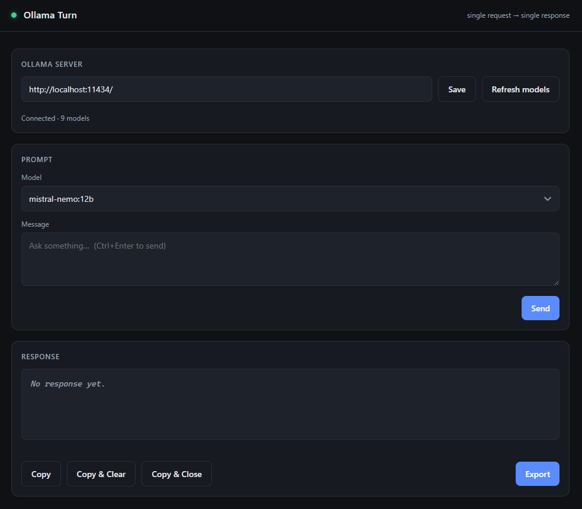

# Ollama Turn

A tiny Windows desktop app for doing a **single request → single response** turn against a remote Ollama server. Native window, modern Chromium (WebView2) UI, no separate web server, no CORS setup.

It also **exports turns to Markdown** in a clean, frontmatter'd format — and can **append** successive turns to the same file, so a deliberately single-turn app doubles as a multi-turn transcript builder.

And it ships a second executable, **`OllamaTurnCLI.exe`**, that gives scripts and coding agents local inference with zero configuration of their own: `OllamaTurnCLI "your prompt"` uses whatever server and model the app is set to. [Jump to the CLI](#cli-zero-config-inference-for-agents-and-scripts).



## Run it

Double-click **`scripts\start.bat`** (it builds on first run, then just launches the exe).

Or from a terminal:

```
dotnet run -c Debug
```

## CLI: zero-config inference for agents and scripts

`OllamaTurnCLI.exe` runs a turn from the command line against **whatever server
and model the app is currently set to** — nothing to configure, no flags to
remember:

```
OllamaTurnCLI "why is the sky blue?"
```

```
Because shorter (blue) wavelengths scatter more in the atmosphere...
```

That is the whole interface. stdout carries the response text and nothing else,
so it pipes and captures cleanly; anything that goes wrong goes to stderr with
exit code `1`. The prompt can arrive on stdin instead:

```
type notes.md | OllamaTurnCLI
```

**Why it needs no configuration:** there is exactly one `config.json`, and it
sits next to the two executables. The app writes the server URL and the selected
model into it; the CLI reads that same file from its own folder. Switch models in
the dropdown and the next CLI call follows you. The app doesn't have to be
running, and nothing is copied anywhere else to fall out of sync.

To run the CLI from a different folder, set `OLLAMA_TURN_CONFIG` to the config
file you want it to use — that takes precedence over everything else.

If no model has been selected yet, one installed model is used automatically;
otherwise the CLI lists what's available and stops rather than guessing.

It can also **change** the settings, so an agent can pick a model without anyone
opening the app:

```
OllamaTurnCLI --list-models
OllamaTurnCLI --set-model mistral:7b
```

`--set-model` is checked against what's actually installed and refuses a name the
server doesn't have, so a typo can't sit in the config breaking every later run.
If the app happens to be open, it notices and updates its dropdown live — no
restart needed.

Full set of options:

```
-m, --model <name>    Use a specific model for this turn only
    --url <url>       Use a different Ollama server for this turn only
-s, --system <text>   Prepend a system prompt
-t, --timeout <sec>   Request timeout (default 600)
    --json            Emit the raw Ollama response (timings, token counts)
    --list-models     List the models installed on the server
    --show-config     Show the resolved URL, model, and where they came from
    --set-model <n>   Save this model as the configured one
    --set-url <url>   Save this server as the configured one
-h, --help            Show usage
```

It's a real console executable, published beside `OllamaTurn.exe` in `dist\` and
self-contained, so a release folder gives you both front ends with nothing to
install. Put that folder on your PATH and `OllamaTurnCLI` works from anywhere.

## Scripts

Helper scripts live in [`scripts/`](scripts):

```
scripts\start.bat      Launch the app (builds first if needed)
scripts\build.bat      Build the Debug configuration
scripts\test.ps1       Run the test suite
scripts\smoke.ps1      Launch the app, verify the window opened, close it
scripts\publish.ps1    Publish both self-contained exes into dist\
scripts\clean.ps1      Remove build artifacts (bin, obj, dist)
```

## Testing

```
powershell -NoProfile -ExecutionPolicy Bypass -File scripts\test.ps1 -NoPause
```

Exercises the built executables the way a caller does — real process, real
arguments and stdin, asserting stdout, stderr and exit code separately. It covers
CLI behaviour and error paths, config discovery, the settings-writing paths, and
finishes with the app smoke test (launch, wait for the UI to report ready, close).

Every case runs against its own config file in a temp sandbox, so a test run can
never change which model you have selected. Cases needing a live Ollama server
report `SKIP` rather than failing when there isn't one. `-SkipServer`, `-SkipApp`
and `-Cli <path>` narrow a run.

## How it works

- The app is a small WPF host around a **WebView2** control. The UI lives in [`www/index.html`](www/index.html).
- The **C# host** (not the browser page) makes the HTTP calls to Ollama, so there is **no CORS** to configure — you do **not** need `OLLAMA_ORIGINS`.
- The window and the CLI are two front ends over one core: config discovery and the Ollama calls live in [`shared/`](shared) and are compiled into both, so they can't drift apart.
- The Ollama URL and the selected model are stored in **`config.json`** sitting next to the exe. The textbox + **Save** button writes to that real file on disk, and picking a model in the dropdown updates it too.
  - Default: `http://localhost:11434/` (point it at your own Ollama host, local or on the network). There is no file until the app first saves a setting; until then the default is used. [`config.example.json`](config.example.json) shows the file's shape.
  - You can edit `config.json` directly in Notepad, or change it in the app.
  - `OllamaTurnCLI.exe` reads the very same file from its own folder — one file, no copies.

## Using it

1. Confirm/enter the Ollama server URL, click **Save** (or **Refresh models**).
2. Pick a model from the dropdown (loaded from `GET /api/tags`).
3. Type a message and click **Send** (or just press **Enter**; **Shift+Enter**
   gives you a new line).
   - Uses `POST /api/generate` with `stream: false`.

## Exporting to Markdown

Click **Export** (bottom-right of the response) to save the turn as a `.md` file:

- The current model generates a short Title Case name; the file is proposed as
  `YYYY-MMdd-HHmm Ollama Turn export - <Generated Title>.md` via a Save As dialog.
- **Pick a new file** → a fresh document is written.
- **Pick an existing file** → choose **Append**, **Overwrite**, or **Cancel**.
  *Append* adds the new turn under the existing frontmatter and updates the
  `updated:` timestamp — run a turn, append, repeat to build a multi-turn record.

Output format (YAML frontmatter + alternating prompt/response sections):

```markdown
---
created: 7/21/2026, 10:25:04 AM
updated: 7/21/2026, 10:25:15 AM
model: "Ollama — llama3:latest"
---

## User prompt
*7/21/2026, 10:25:04 AM*

Why is the sky blue?

## Ollama response
*7/21/2026, 10:25:15 AM*

Because shorter (blue) wavelengths scatter more in the atmosphere…
```

## Files

```
scripts/             Launch, build, smoke test, publish, and clean helpers
OllamaTurn.csproj    WPF + WebView2 project (the app window)
App.xaml(.cs)        App entry
MainWindow.xaml(.cs) WebView2 host + config I/O + Ollama proxy + Markdown export
www/index.html       The UI (HTML/CSS/JS, self-contained)
shared/              Config discovery + Ollama calls, compiled into both exes
cli/                 OllamaTurnCLI project: the command-line front end
config.example.json  The shape of config.json: { "url": "..." } — the app adds "model"
spec/                Design notes: the build story, the export format, the CLI
```

## Notes

- The `config.json` that matters at runtime is the one next to the exe
  (`bin\Debug\net9.0-windows\config.json` when run from a build). The app writes
  it on first save, and no build or publish ever copies one over it. A
  `config.json` at the repository root is ignored by git, so a real server
  address cannot be committed by accident.
- Requires the **WebView2 Runtime** (ships with modern Windows 10/11 and Edge) and the **.NET 9 SDK**.

## License

MIT © [Dazzle Networks](https://dazzlenetworks.com) — see [LICENSE](LICENSE).
